# Two-Factor Authentication (TOTP)

If a password is leaked, someone can sign in to ECP and operate clusters, edge nodes, and configurations. **Multi-factor authentication (MFA)** adds a second check: you must both **know the password** and **have the authenticator app on your phone**. Without your phone, a stolen password is not enough.

Codes are **calculated on the phone** (a 6-digit TOTP that refreshes about every 30 seconds) and do not require the phone to reach ECP, so MFA works even without outbound internet. Common apps: Microsoft Authenticator, Google Authenticator, and other TOTP apps such as Authy, 1Password, or the built-in Passwords app on iPhone.

:::tip Scope
MFA applies only to **local accounts** that sign in with **username and password**. Accounts that enter through enterprise SSO do not get an extra local TOTP step; their policy stays with the identity provider.
:::

:::tip How to read this page
- **End users**: first-time bind, daily sign-in, recovery codes, replacing the authenticator.
- **System admins**: pre-enroll, turn the switch on/off, reset another user’s MFA.
- **Operations**: host emergency reset and master key (skip unless you run the deployment).
:::

Login page:

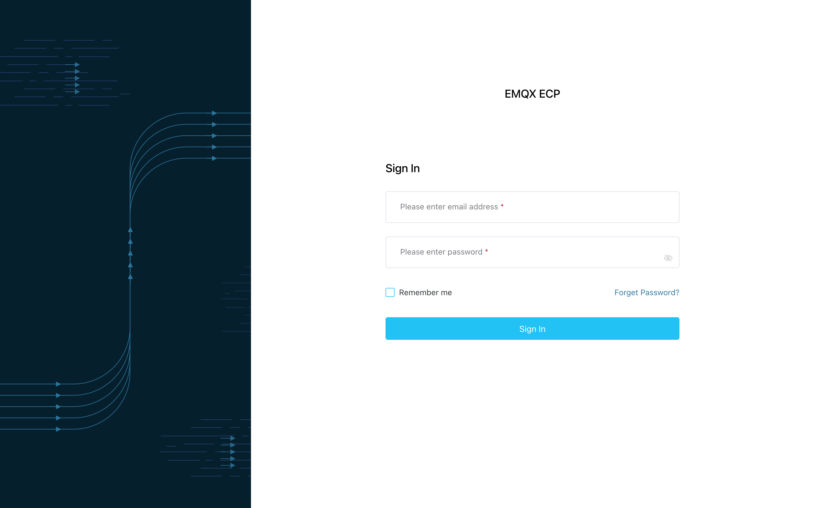

---

## End users

After a system admin turns MFA on, local accounts must finish binding or enter a verification code after a correct password before they can enter the system.

### First-time bind

1. Enter email and password on the login page.
2. After a correct password, open **Set up an authenticator app** (step 1 of 2).
3. Scan the QR code with your authenticator app, or use **Show the setup key** to enter the secret manually.
4. Enter the current 6-digit code from the app and continue.
5. On **Save recovery codes** (step 2): **copy or download** the ten codes immediately and store them offline, confirm that you saved them, then finish.
6. Enter the system. Later sign-ins no longer show recovery codes.

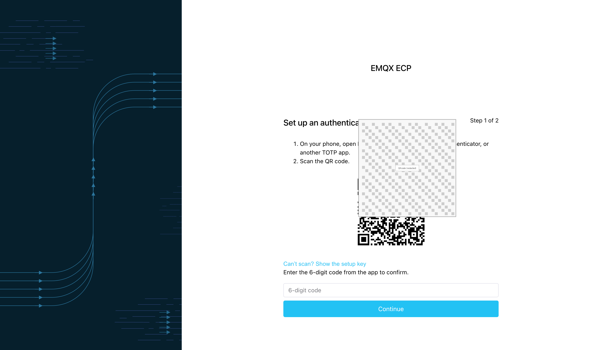

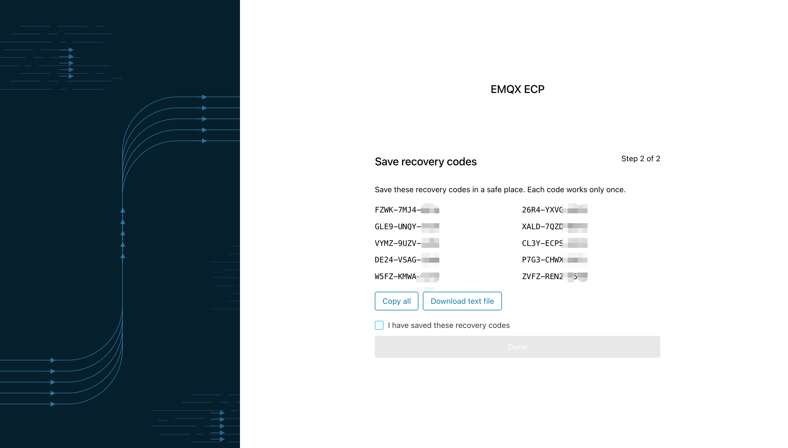

If you set a password from an invite email: when MFA is on, you must complete the same bind-and-save-recovery-codes flow before entering; when MFA is off, setting the password is enough.

:::tip
Refreshing or timing out during binding invalidates the QR code—sign in with the password again. Wrong codes show a failure message; too many failures for the same attempt require a new sign-in to get a new QR code.
:::

### Day-to-day sign-in

1. Enter email and password on the login page.
2. After a correct password, open **Verify identity** and enter the current 6-digit code from the authenticator app.
3. Enter the system after verification succeeds.

You can also choose **Use a recovery code** or **Back to login**.

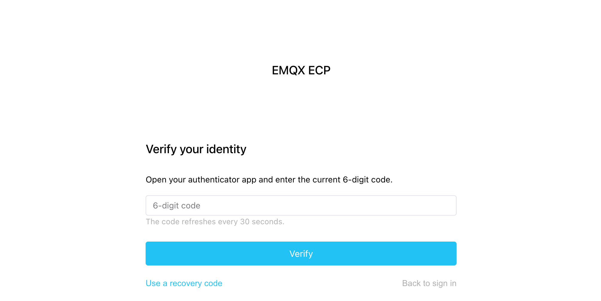

Wrong codes show a unified failure message. Too many failures for the same challenge, or an expired challenge, send you back to the password page. A short cool-down may apply after too many failures in a short window; during cool-down, even a correct password will not open the verify step—try again later.

### Lost phone: re-bind with a recovery code

1. On **Verify identity**, choose **Use a recovery code** and submit an unused code.
2. Complete binding on a **new phone** and save **ten new** recovery codes.
3. After you confirm saving the new codes, you enter the system; the **old authenticator stops working**, and remaining old recovery codes are invalidated.

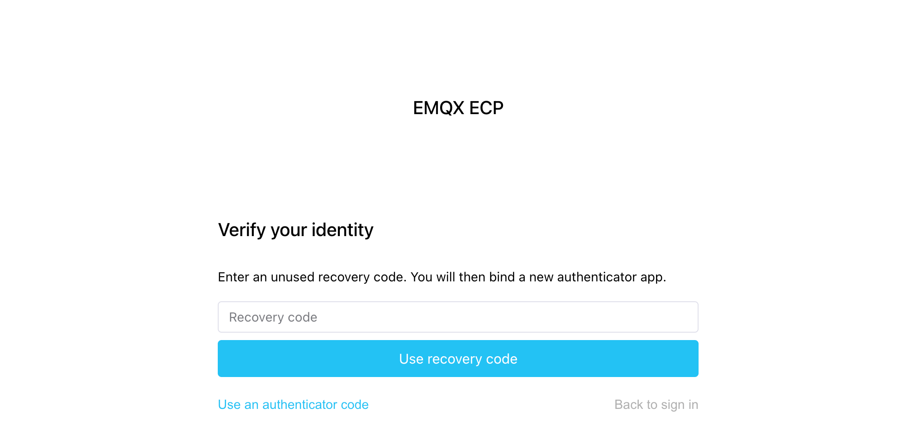

:::warning
- After you submit a recovery code, you cannot enter the system until the new bind is confirmed and new recovery codes are saved.
- If you consume a recovery code and abandon re-bind, that code is spent, but the old authenticator still works until a new bind is confirmed.
- When all ten recovery codes are used, ask a system admin to reset MFA in user management, or use a host emergency reset.
:::

### Replace the authenticator while signed in

When MFA is on, manage it from **User Center** (personal profile): replace the authenticator or regenerate recovery codes.

1. Open the MFA entry in User Center.
2. Enter the **current** authenticator’s 6-digit code to confirm identity.
3. Follow the bind flow and save ten new recovery codes.

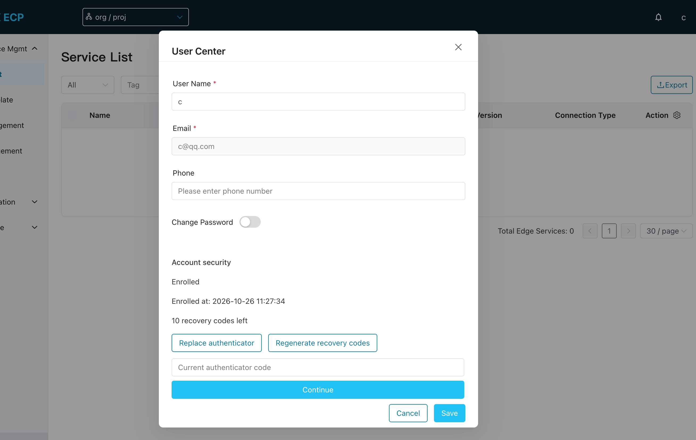

You stay in User Center; the existing session remains valid; the old authenticator and old recovery codes stop working. While MFA is on, you **cannot** turn MFA off for yourself.

:::warning Recovery codes are shown only once
Copy or download them immediately and store them offline. You cannot view the same plaintext again after leaving the page. Admins cannot read your recovery codes or sign in on your behalf with them.
:::

---

## System admins

The global switch lives under **System Settings → General Settings → Multi-factor authentication**. Type can be **Disable** or **Open**. Enterprise SSO accounts stay on the identity provider’s policy; this switch does not add a second check for them.

Disabled:

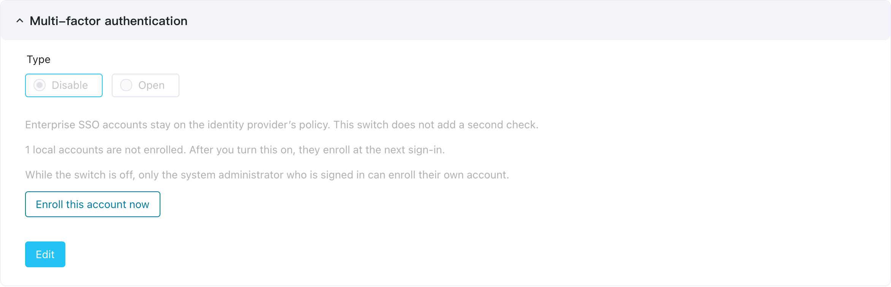

Open:

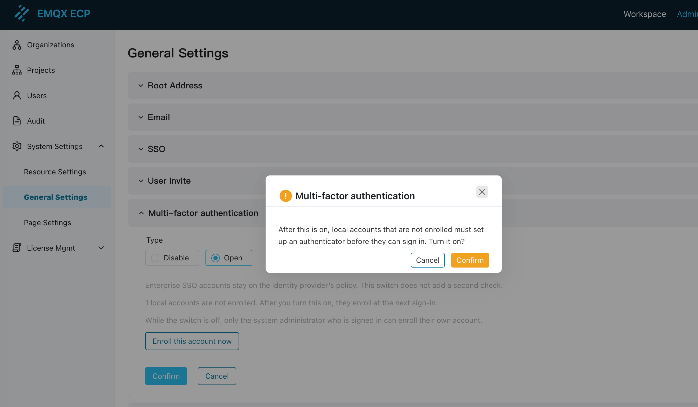

### Why pre-enroll before you turn it on

After the switch is on, **every local account** (including system admins) must complete MFA on the next sign-in. Before enabling, at least the admin who will operate the switch should enroll and securely store recovery codes:

1. After the switch is on, admins also need a verification code. Enabling without enrolling first can lock you out of System Settings once the current session expires.
2. When a regular user loses both phone and recovery codes, a signed-in system admin must reset MFA in user management. If no admin can sign in, you must use host emergency reset.
3. Enroll while the switch is still off: you stay on the settings page, the current session stays valid, and later sign-ins still use password only. Turn the switch on only after you can use the authenticator and recovery codes reliably.

The product does **not** require “at least one enrolled admin” before you can turn the switch on. You can enable MFA with no pre-enroll, but then the first person to sign in must complete binding, and an admin who cannot get in must rely on host emergency reset. If you have two or more system admins, each should enroll so one can reset the other on the web.

### Enroll this account while the switch is off

1. Sign in as a **system admin** (MFA still disabled).
2. Open **System Settings → General Settings → Multi-factor authentication**.
3. Choose **Enroll this account now**.
4. In **Set up an authenticator app**, scan the QR code (or enter the setup key), then enter the 6-digit code to confirm.
5. Immediately copy or download the ten recovery codes and confirm that you saved them.

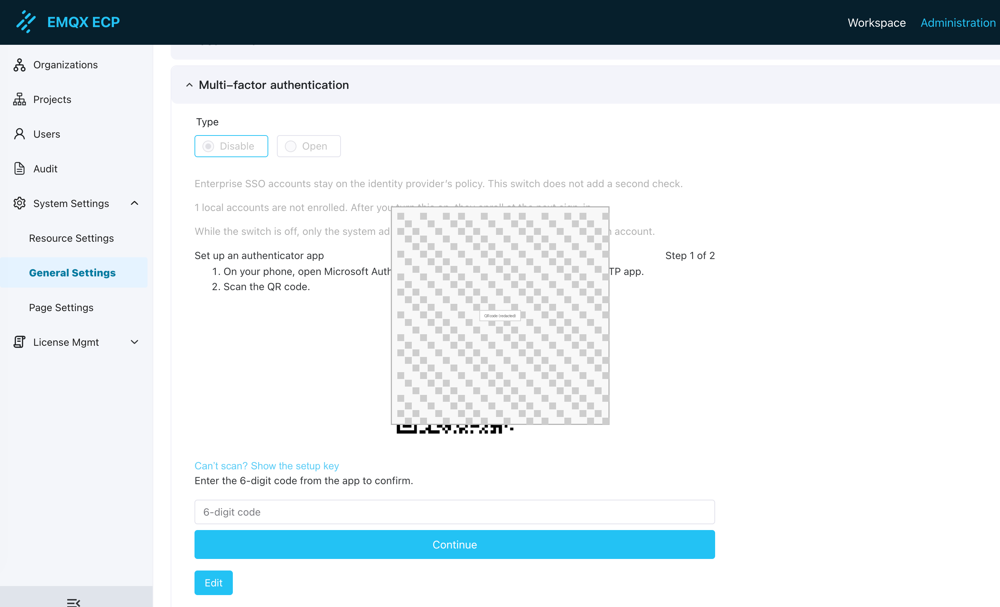

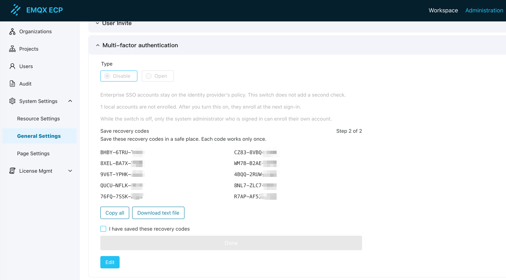

You remain on the settings page; the switch stays off; signing out and back in still uses password only. Regular users have no enroll entry here and cannot enroll for someone else.

:::warning
If you view recovery codes but leave without confirming that you saved them, you cannot view the same plaintext again. After the switch is on, a correct TOTP will not take you straight into the system; ECP will ask you to confirm saving a new set of recovery codes first.
:::

### Turn MFA on or off

1. In the Multi-factor authentication panel, click **Edit**.
2. Choose **Open** or **Disable**, then confirm.

The Open / Disable appearance after saving is shown in the settings screenshots above.

**After turning on:**

- There is no gate that counts how many admins have already enrolled.
- Users who are already signed in are not kicked out immediately; their sessions remain usable until they expire naturally.
- User Center shows MFA-related actions; the user list shows a **Two-factor authentication** column after the SSO-related columns.
- Unbound local users must complete binding and save recovery codes on the next password sign-in.
- Bound local users must enter the current 6-digit code after a correct password.

**After turning off:**

- New password sign-ins return to password-only.
- Bound authenticator and recovery-code data are kept. When you turn the switch on again, bound users enter a code; unbound users go through QR binding first.

### Reset another user’s MFA

When a user loses the phone and has no recovery codes left, or you must force a re-bind:

1. As a signed-in system admin, open **Users**.
2. For the target **local user**, choose **Reset two-factor authentication** (or the equivalent action) and enter the required reason.
3. The target becomes unbound; their existing sessions become invalid.
4. The target signs in with the **same password** and completes first-time binding (password change is not required).

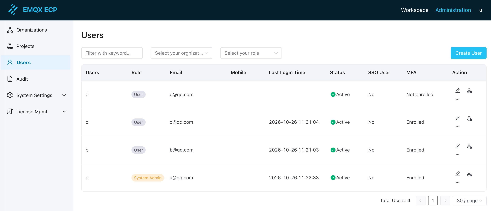

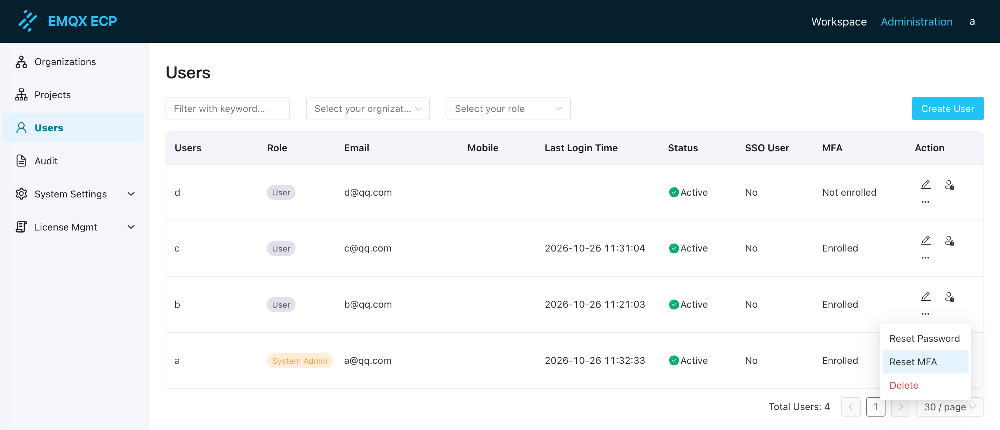

Your own session and the global switch are unchanged. Regular users have no reset entry; SSO users have no local MFA reset. One system admin can reset another without affecting other bound users.

---

## Operations (deployment host)

For people who run the deployment and handle break-glass cases. End users can skip this section.

### Emergency reset

When no signed-in system admin can perform a web reset (for example all super-admins are locked out), reset a specific local account on the deployment host. Use a controlled process with **dual approval** and audit.

From the ECP deployment directory:

```shell
./emqx_ecp_ctl reset-admin-mfa
```

The command runs inside the container and **does not** call the web port (for example 8082). Effects:

- Invalidate that local account’s authenticator, recovery codes, and in-progress verify / bind flows;
- Invalidate that account’s existing sessions;
- **Do not** issue a new session, **do not** change the password, **do not** elevate privileges.

The target then signs in with the original password and re-binds. MFA for other accounts stays in effect.

:::tip
- Changing only the password, or turning the global switch off, is **not** a per-user emergency reset. Turning the switch off returns the whole site to password-only sign-in.
- Command output never includes verification codes, recovery codes, or QR content, and cannot reset SSO accounts.
:::

### Master key (brief)

ECP encrypts each user’s authenticator secret with `ECP_MFA_MASTER_KEY` from the deployment environment. All instances must use the same key. For local Docker Compose, `./emqx_ecp_ctl configure` generates and writes the variable into `.env` when missing; running configure again keeps the existing value. To rotate deliberately:

```shell
./emqx_ecp_ctl configure --rotate-mfa-key
```

:::warning
Rotating a master key that is already in use makes existing bound users’ codes fail verification. Rotate only with a clear plan and arrange for users to re-bind. When the switch is on, a missing or invalid master key prevents new MFA sign-ins from completing; when the switch is off, ordinary password sign-in is unaffected. Do not commit a default master key to the repository.
:::

---

## Usage notes

- **Session invalidation**: Resetting MFA, changing password, resetting password by email, disabling an account, or removing the system-admin role invalidates that account’s existing sessions.
- **Shared accounts**: If several people share one local super-admin account, TOTP cannot identify the actual operator—avoid sharing.
- **Audit**: Bind, verification failures, recovery-code use, authenticator replacement, admin reset, and switch changes are auditable. Audit records do not include verification codes, recovery codes, or secrets.
