# 二次验证（TOTP）

密码一旦泄露，别人就能直接进入 ECP，操作集群、边缘节点和配置。**二次验证**在密码之外再加一道关：登录时既要「知道密码」，也要「拿着已绑定的手机验证器」。即便密码落到别人手里，没有你的手机，也进不了系统。

验证码由手机上的验证器 App **本地计算**（约每 30 秒刷新一次 6 位数），不要求手机访问 ECP，现场没有外网也能用。常见 App：Microsoft Authenticator、Google Authenticator，以及 Authy、1Password、iPhone 自带「密码」等支持 TOTP 的应用。

:::tip 适用范围
二次验证只作用于用**用户名和密码**登录的**本地账号**。通过企业单点登录（SSO）进入 ECP 的账号，不会再叠加本地验证码；安全策略仍由身份提供商负责。
:::

:::tip 本文怎么读
- **普通用户**：首次绑定、日常登录、恢复码、换手机。
- **系统管理员**：预绑定、开关、在用户管理中重置他人。
- **运维**：主机紧急重置与主密钥（可跳过，除非你负责部署）。
:::

登录页示意：

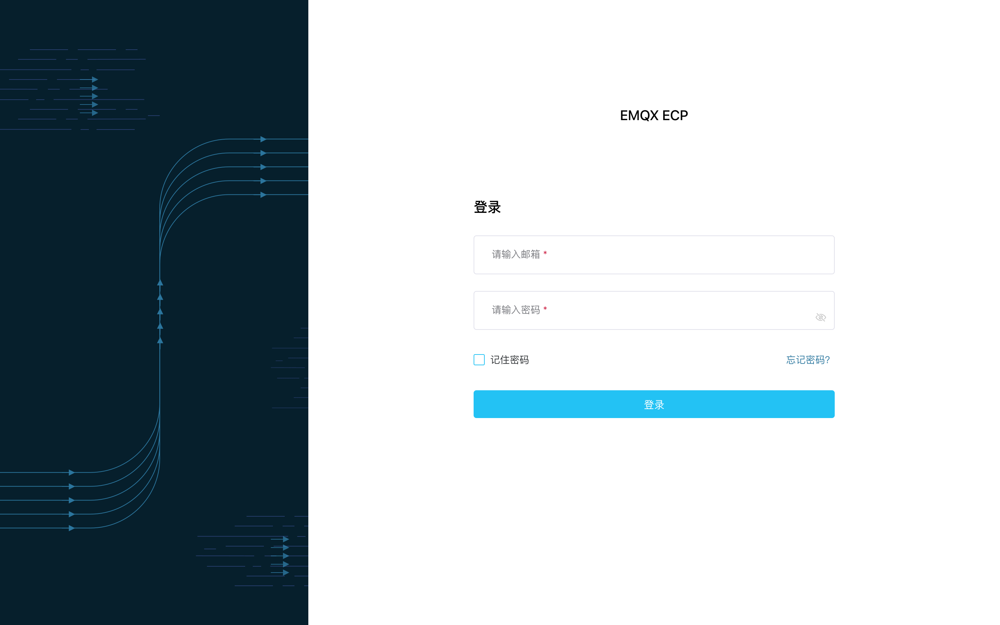

---

## 普通用户

系统管理员打开二次验证后，本地账号在密码正确之后，还需要完成绑定或输入验证码，才能进入系统。

### 第一次绑定

1. 在登录页输入邮箱和密码。
2. 密码正确后，页面进入**设置验证器 App**（第 1 步，共 2 步）。
3. 用手机验证器 App 扫描二维码；无法扫码时可点**显示手工设置密钥**，手工录入。
4. 输入 App 当前显示的 6 位验证码，点**继续**。
5. 进入**保存恢复码**（第 2 步）：立刻**复制或下载** 10 个恢复码并离线保管，勾选已保存后点**完成**。
6. 进入系统。之后日常登录不再展示恢复码。

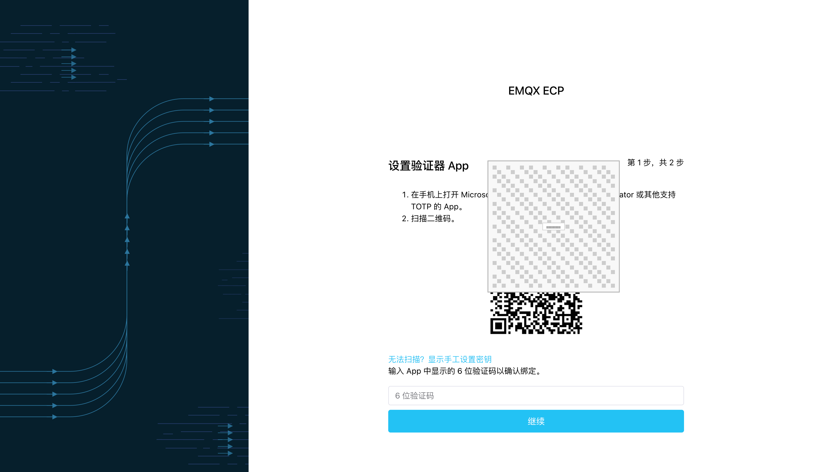

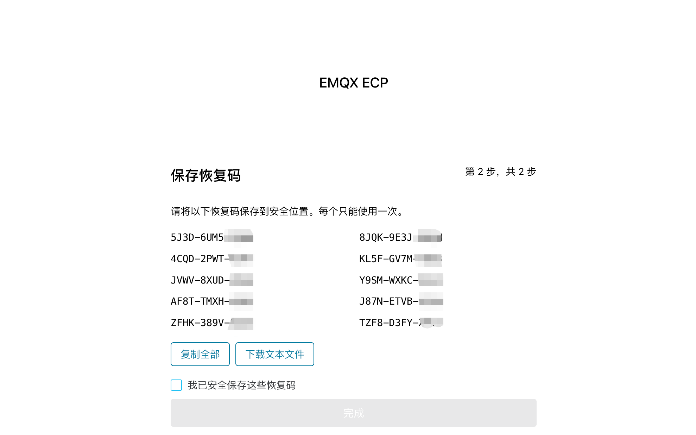

若你是通过邀请邮件设密进入的：开关已打开时，设完密码后同样要完成绑定和保存恢复码，才能进系统；开关关闭时，设完密码即可进入。

:::tip 提示
绑定过程中刷新页面或超时后，二维码会失效，请重新输入密码再走一遍。验证码填错时页面会提示失败；连续失败次数过多时，需要重新登录获取新的二维码。
:::

### 日常登录

1. 在登录页输入邮箱和密码。
2. 密码正确后进入**验证身份**，输入验证器 App 里当前的 6 位验证码。
3. 通过后进入系统。

页面上还可以选择**使用恢复码**，或**返回登录**。

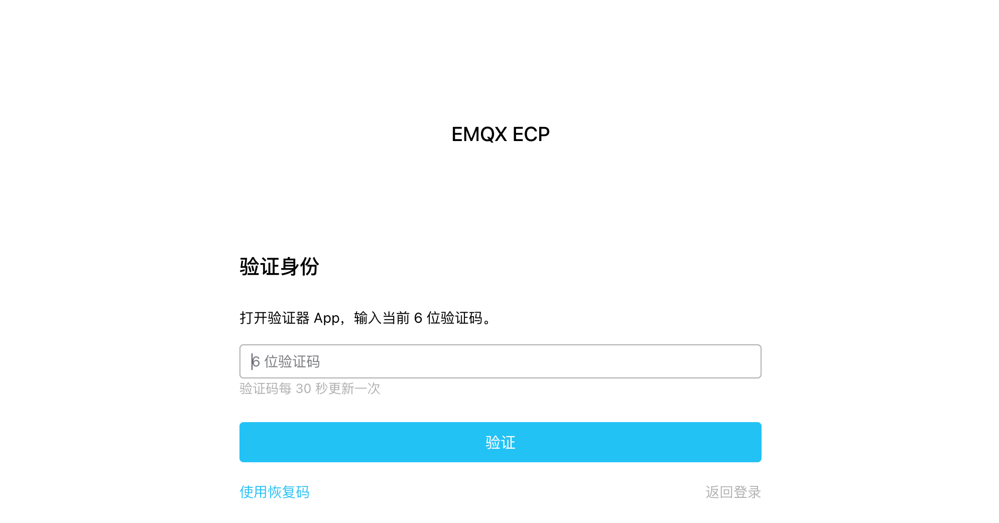

验证码错误时只显示统一提示（例如无效或已过期）。同一次验证连续失败过多或超时后，需要回到登录页重新输密码。短时间内累计失败过多时，账号可能短暂冷却，期间即使密码正确也不会进入验证步骤，稍后再试即可。

### 手机丢了：用恢复码重新绑定

1. 在**验证身份**页选择**使用恢复码**，提交一个尚未用过的恢复码。
2. 按页面引导用**新手机**完成绑定，并保存**新的** 10 个恢复码。
3. 确认保存后进入系统；**旧验证器立刻失效**，旧的未用恢复码也一并作废。

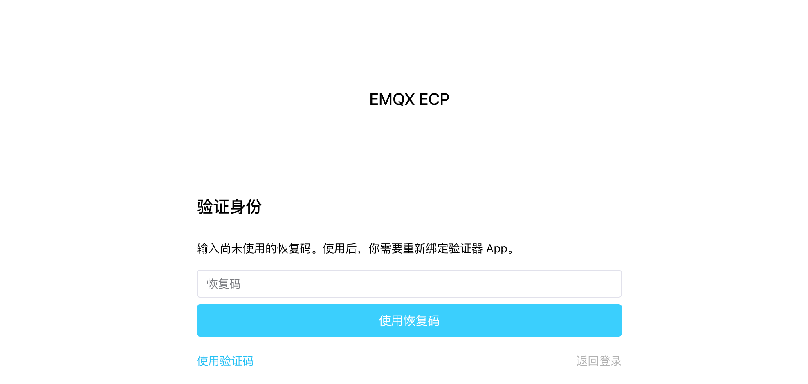

:::warning 注意
- 提交恢复码之后，在完成新绑定并确认保存新恢复码之前，**不会**进入系统。
- 若用掉一个恢复码后中途放弃，该码已作废，但旧验证器在新绑定确认前仍可用来登录。
- 10 个恢复码都用尽后，请联系系统管理员在用户管理中重置，或由运维在部署主机做紧急重置。
:::

### 已登录时更换验证器

开关打开后，可在**个人中心**管理二次验证（更换验证器或重新生成恢复码）：

1. 打开个人中心的二次验证相关入口。
2. 先输入**当前**验证器中的 6 位验证码确认身份。
3. 按引导完成新绑定，并保存新的 10 个恢复码。

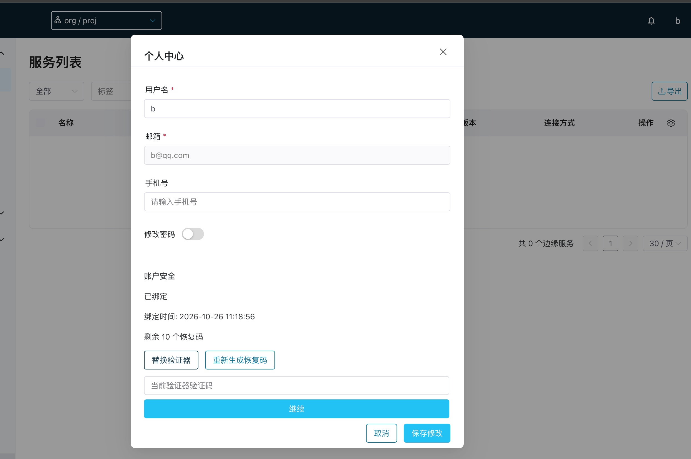

完成后仍留在个人中心，原来的登录继续有效；旧验证器和旧恢复码失效。开关打开时，你**不能**自行关掉二次验证。

:::warning 恢复码只展示一次
绑定时请马上复制或下载并离线保存。离开页面后无法再查看同一批明文。管理员也看不到你的恢复码，更不能用它们代你登录。
:::

---

## 系统管理员

全局开关在：**系统设置 → 通用配置 → 多重验证**。类型可选**关闭** / **开启**。企业 SSO 账号仍由身份提供商策略负责，这里不会再叠加一次验证。

关闭状态：

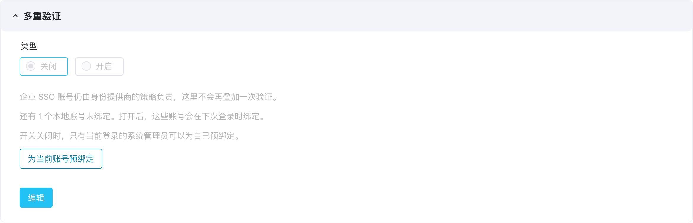

开启状态：

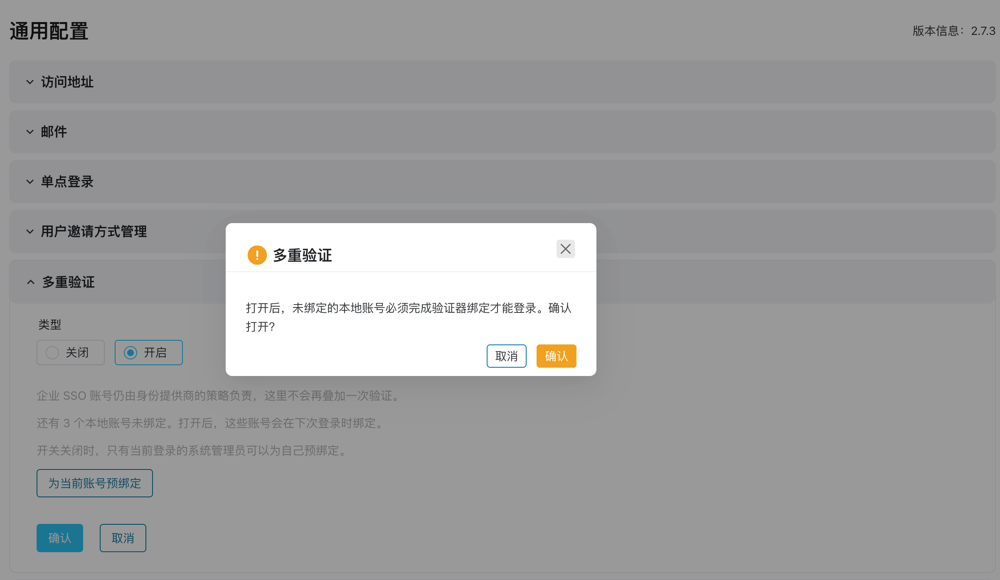

### 为什么建议先预绑定再开启

开关打开后，**所有本地账号**（含系统管理员）下次登录都要完成二次验证。建议在开启前，至少由当前操作的系统管理员先完成预绑定，并妥善保存恢复码：

1. 打开之后管理员自己也要靠验证码进系统。若未预绑定就打开，当前登录过期后，可能把自己挡在门外。
2. 普通用户丢了手机且恢复码用尽时，需要已能登录的系统管理员在用户管理中重置。若所有管理员都进不去，只能走主机紧急重置。
3. 预绑定在开关仍关闭时进行：完成后仍停在设置页，当前登录继续有效；退出再登录也仍然只输密码。确认验证器和恢复码可用后，再打开开关。

系统**不强制**「必须先有人预绑定才能打开」。无人预绑定时也可以打开，但打开后第一个进系统的人也要先绑定；管理员若自己过不去，只能依赖主机紧急重置。有两名以上系统管理员时，建议各自预绑定，方便互相重置。

### 开关关闭时为自己预绑定

1. 以**系统管理员**登录（多重验证仍为关闭）。
2. 打开 **系统设置 → 通用配置 → 多重验证**。
3. 点击**为当前账号预绑定**。
4. 在**设置验证器 App**中扫码（或手工密钥），输入 6 位验证码确认。
5. 立刻复制或下载 10 个恢复码，确认已保存。

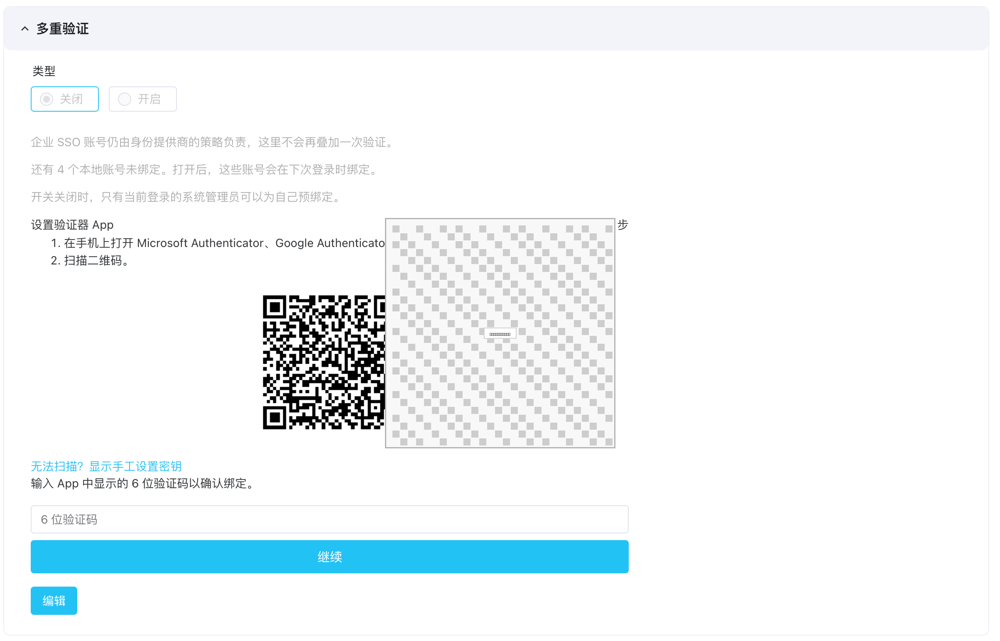

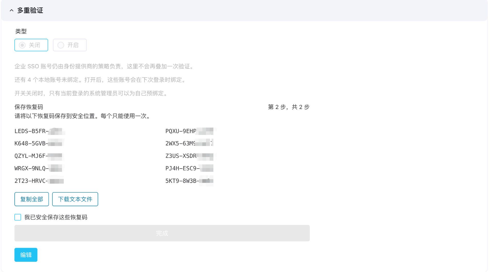

完成后仍停在设置页，开关仍是关闭；退出再登录仍然只输密码。普通用户没有预绑定入口，也不能替别人绑定。

:::warning 注意
若看过恢复码但未确认保存就离开，之后无法再查看同一批明文。开关打开后，即使用正确验证码，系统也会要求你确认保存一批新的恢复码，确认后才能进入系统。
:::

### 打开或关闭开关

1. 在多重验证面板点击**编辑**。
2. 选择**开启**或**关闭**，再确认保存。

保存后的开启/关闭外观见上文「多重验证设置」截图。

**开启之后：**

- 不要求事先统计「已预绑定的管理员人数」。
- 当前已登录的用户不会被立刻踢出，可继续用到会话自然过期。
- 个人中心会出现二次验证相关入口；用户管理列表在「SSO 用户」相关列后会出现「二次验证」列。
- 未绑定的本地用户下次密码登录时，须先完成绑定并保存恢复码。
- 已绑定的本地用户下次登录时，密码正确后还须输入 6 位验证码。

**关闭之后：**

- 新的密码登录恢复为只输密码即可进入。
- 已绑定的验证器和恢复码数据会保留。再次打开时，已绑定用户直接输验证码，未绑定用户先扫码。

### 在用户管理中重置他人的二次验证

当用户丢失手机且恢复码用尽，或需要强制其重新绑定时：

1. 以已能登录的系统管理员进入**用户管理**。
2. 对目标**本地用户**选择**重置二次验证**（或同等操作），并填写必填原因。
3. 目标用户变为未绑定，其已有登录失效。
4. 对方使用**原密码**重新登录，按首次绑定流程重新绑定（不强制改密）。

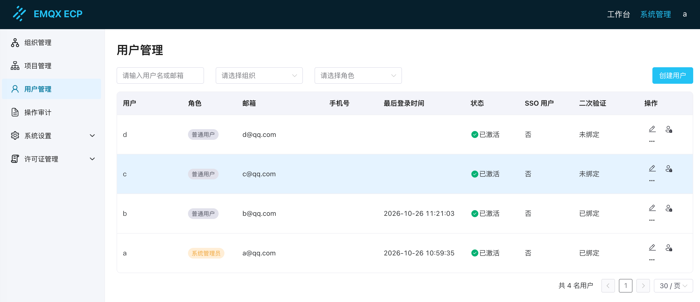

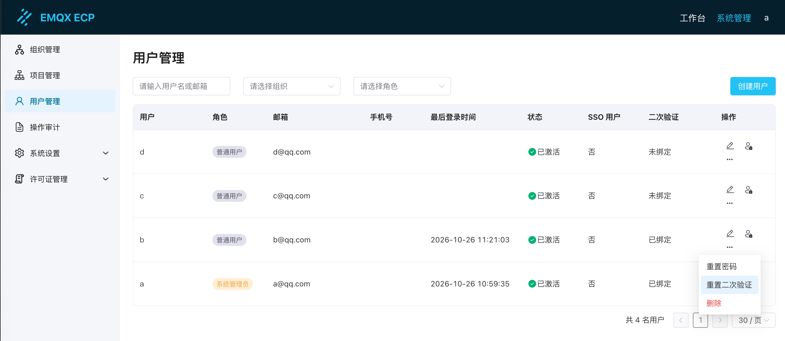

操作者本人的登录和全局开关不变。普通用户无此入口；SSO 用户无本地二次验证重置。一名系统管理员可以重置另一名系统管理员，不影响其他已绑定用户。

---

## 运维（部署主机）

本节面向负责部署与应急的运维人员；普通用户可跳过。

### 紧急重置

当没有可用的已登录系统管理员做网页重置时（例如全体超管无法登录），可在部署主机上对指定本地账号做紧急重置。请走受控流程与**双人审批**，并留下审计记录。

在 ECP 部署目录执行：

```shell
./emqx_ecp_ctl reset-admin-mfa
```

该命令在容器内执行，**不会**访问网页端口（如 8082）。效果包括：

- 作废该本地账号的验证器、恢复码，以及进行中的验证 / 绑定；
- 使该账号旧的登录失效；
- **不**签发新登录、**不**改密码、**不**提权。

重置后，目标用户用原密码登录并重新绑定。其他账号的二次验证继续生效。

:::tip 说明
- 只改密码，或把全局开关关掉，都**不是**针对单人的紧急重置。关闭开关会使整站恢复为单步密码登录。
- 命令输出中不会包含验证码、恢复码或二维码，也不能用于重置 SSO 账号。
:::

### 主密钥（简要）

ECP 使用环境变量 `ECP_MFA_MASTER_KEY` 加密保存用户的验证器密钥。所有实例须使用同一把。本地 Docker Compose 安装时，`./emqx_ecp_ctl configure` 会在缺失时自动生成并写入 `.env`；再次 configure 会保留已有值。确需更换时：

```shell
./emqx_ecp_ctl configure --rotate-mfa-key
```

:::warning 注意
更换已在用的主密钥后，已绑定用户的验证码将无法通过校验。请仅在有明确计划时轮换，并安排用户重新绑定。开关打开时若主密钥缺失或无效，新的二次验证登录无法完成；开关关闭时普通密码登录不受影响。请勿把主密钥写入代码仓库。
:::

---

## 使用注意

- **会话失效**：重置二次验证、修改密码、邮件重置密码、禁用账号或取消系统管理员后，该账号旧的登录会失效。
- **共享账号**：多人共用同一本地超管账号时，二次验证无法区分实际操作者，请尽量避免。
- **审计**：绑定、验证失败、使用恢复码、更换验证器、管理员重置和开关变更等可在操作审计中追溯；审计内容不会包含验证码、恢复码或密钥原文。
